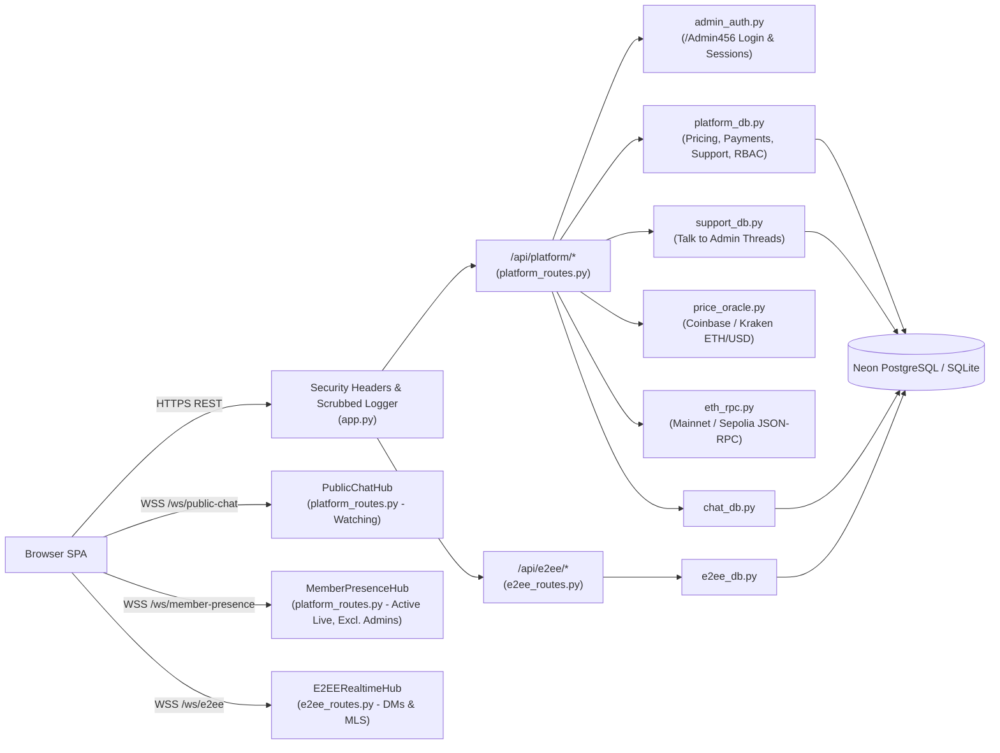

# Backend Architecture & Technical Implementation

## 1. Technical Stack Overview

- **Runtime**: Python 3.10+ (tested on Python 3.14)
- **Framework**: [FastAPI](https://fastapi.tiangolo.com/) + ASGI WebSockets (`uvicorn`)
- **Database Engine**: **Neon PostgreSQL** (`psycopg2` `ThreadedConnectionPool`, `DB_POOL_MIN=3`, `DB_POOL_MAX=10`) with liveness health pings (`SELECT 1` after `DB_POOL_VALIDATE_AFTER_SECS=5`), idle connection purging + `503 Retry-After: 1` recovery in `app.py`, and persistent SQLite (`backend/local_dev.sqlite3`) fallback for local development when `NEON_DATABASE_URL` is omitted (automatic `:memory:` SQLite strictly for unit testing).
- **Live Pricing Oracle**: `price_oracle.py` fetches live ETH/USD spot rates from Coinbase (with Kraken fallback), caches for `ETH_PRICE_CACHE_SECS=60`, retains stale quotes up to `ETH_PRICE_STALE_OK_SECS=3600`, and falls back to the admin-configured fixed `eth_usd_price`.
- **Ethereum Verification**: Read-only JSON-RPC client (`eth_rpc.py`) + `eth-account` (`EIP-4361` SIWE / `EIP-191` signature recovery)
- **Server-Side Cryptography**: `cryptography` (OpenSSL `Ed25519PublicKey` verification for device bundles, NIST `P-256` curve validation) + `hashlib` (`SHA-256`, salted `BLAKE2b` rate-limit keys) + `secrets`

> **Zero Custodial Escrow & Non-Custodial Verification**: All legacy payment/escrow workers, MongoDB dependencies, and legacy `Level 7+` qualification engines have been completely removed. Persistent data lives exclusively in normalized PostgreSQL tables or persistent local SQLite. The system features an authoritative, server-side verified on-chain payment record system (`payment_records`) and read-only Ethereum JSON-RPC balance/receipt verification (`eth_rpc.py`). Zero custodial private keys are stored.

---

## 2. Request & Real-Time Architecture



---

## 3. Core Architectural Invariants

1. **Permanent Internal `user_id`**:
   - Every user record in `chat_users` is keyed by immutable `usr_<24-hex>`.
   - Changing `@username` or rotating primary Ethereum wallets updates `chat_users` / `chat_user_wallets`, appends to `username_history` / `wallet_change_history`, and revokes stale wallet sessions without breaking conversation foreign keys or E2EE device identities.
2. **Idempotent On-Chain Payment Verification & Recipient Validation**:
   - Submitted transaction hashes (`POST /api/platform/payments/verify`) are verified via Ethereum JSON-RPC receipts (`eth_getTransactionReceipt` + `eth_getTransaction`), using Mainnet (`chain_id=1`, `RPC_URL_MAINNET`) or Sepolia (`chain_id=11155111`, `RPC_URL_SEPOLIA`) as selected by Admin `default_balance_chain_id`.
   - Authoritative destination check: transaction recipient must strictly match the server-controlled `authorized_payment_destination` setting. Wrong-destination and pending contract-creation transactions (`to=None`) are rejected immediately (`failed`).
   - Sender check: transaction sender must match the authenticated user's active wallet address.
   - Network check: transaction chain ID must be within the allowed payment chain IDs.
   - Unique constraints on `transaction_reference` ensure transactions cannot be processed twice or replayed.
   - Purpose handling: transactions are tagged with `purpose` (`platform_entry` or `group_entry`), setting `chat_users.is_platform_paid = True` upon verified platform admission.
   - Pending, failed, or reversed transactions are strictly rejected.
3. **Zero-Plaintext E2EE Relay**:
   - All `/api/e2ee/dm/messages`, `/api/e2ee/groups/*/messages`, and `/api/e2ee/attachments` models enforce Pydantic `extra="forbid"` plus recursive `assert_zero_plaintext(...)` rejecting any field named `plaintext`, `text`, `body`, `message`, `private_key`, `seed_phrase`, or `pickle_key`.
   - DM attachment uploads validate scope via `_resolve_upload_attachment_scope` before base64 decoding or quota deduction (refuses muted users, enforces bidirectional `user_blocks` on both `usr_...` and `conv_...`, and verifies active DM participation).
4. **Optimistic Concurrency & Atomic Chat Feature Serialization**:
   - `submit_mls_commit_atomic` locks the `chat_groups` row (`SELECT ... FOR UPDATE` on PostgreSQL) and requires `expected_epoch == current_epoch`, returning `HTTP 409 Conflict` with `missing_commits` if another member advanced the group first.
   - `chat_features_db.set_pin` executes inside `_in_transaction(..., lock_key="pins:" + scope_key)` (PostgreSQL `pg_advisory_xact_lock` / SQLite `RLock`) with strictly monotonic `pinned_at` (`+1 µs` on fast-clock ties) so concurrent pins never exceed `PIN_LIMIT` (`3`) or evict the wrong message; `chat_features_db._ready_for` and `support_db._sqlite_schema_ready_for` track DB connection/pool object identity (`is`). `chat_dm_messages` includes `(sender_user_id, seq)` and `(recipient_user_id, seq)` indexes for fast DM conversation listing.
5. **Server-Side Group Policy & Paid-Member Access Enforcement**:
   - `eth_rpc.py` verifies live `eth_getBalance` directly from Ethereum Mainnet/Sepolia RPC nodes only on explicit verify actions or when `verify_user_meets_group_policy(..., refresh_balance=True)` sees a stale balance fail a group's `min_eth_balance_wei` check during join/discovery (`refresh_verified_balance_if_stale`, `BALANCE_REFRESH_SECS=600`, `60 s` per-member cooldown); group message sends pass `refresh_balance=False` so messaging never triggers RPC calls.
   - `update_group_policy_endpoint` enforces verified `superadmin` authentication (`admin_verified`) for paid-group pricing changes (`is_paid`, `entry_fee_usd`, `entry_fee_yearly_usd`), falling back safely to normal session rights if an invalid `X-Admin-Token` is sent.
   - Paid-Member Open Public Chat: both `GET` and `POST` `/api/platform/public-chat/messages` require `_require_paid_member_ctx` (legacy guest toggles and dead guest-posting branches have been removed).
   - Admin Presence Exclusion: `E2EERealtimeHub` excludes administrators (`superadmin`, `moderator`, `ADMIN_WALLET_ADDRESSES`) from `active_live` counts and `is_user_online` status indicators.
6. **Environment Loading, Privacy, CORS & Log Hygiene**:
   - `app.py` explicitly loads `backend/.env` by absolute path (`load_dotenv(..., override=True)`) outside test runs (`_is_test_env()` / `eth_rpc.is_test_environment()` matching `TESTING=1`, `pytest`, and `unittest`).
   - `app.py` strips client IP/port and URL query strings from access logs, sets `Content-Security-Policy`, `X-Frame-Options: DENY`, `Referrer-Policy: no-referrer`, and scrubs validation/exception payloads before returning errors.
   - `CORSMiddleware` is registered outermost (after `detailed_request_logger`) so `413`/`500`/`503` responses carry CORS headers, and allows `FRONTEND_URL` origins plus any local dev/preview port (`localhost`, `127.0.0.1`, `[::1]`) via `allow_origin_regex`.
   - `GET /api/health` calls `eth_rpc.peek_rpc_health_status()` with zero RPC network calls (probing runs once at startup and in `/api/platform/admin/overview` via non-blocking stale-while-revalidate `eth_rpc.get_cached_rpc_health_status()`, `RPC_HEALTH_TTL_SECS = 30.0`), and supports `?deep=1` to verify database liveness and wake a suspended Neon compute.
   - Dropped Neon/PostgreSQL connections caught by `detailed_request_logger` purge idle pool connections and respond with `503 Service Temporarily Unavailable` + `Retry-After: 1` (`retryable: true`).
7. **Hardened Standalone Admin Console Authentication & Fast Overview Queries (`admin_auth.py`, `platform_db.py`)**:
   - Credentials (`ADMIN_LOGIN_ID`, `ADMIN_LOGIN_PASSWORD`) live exclusively in server-side `.env` / host secrets and are never bundled into frontend code; login fails closed (`503`) if either variable is unset.
   - `attempt_login` performs constant-time `hmac.compare_digest` over `SHA-256` digests of both fields, applies a global slowdown (each failed attempt waits longer, up to 8 s) and a cap of `4` simultaneous attempts (reads no IP or visitor data; no lockout so strangers cannot lock the real admin out), refuses to run at all while the configured credentials fail the strength policy (`credential_problems`), executes zero SQL queries, and stores issued 256-bit random session tokens in memory strictly as `SHA-256` hashes with `30`-minute idle and `4`-hour absolute expiry (`POST /api/platform/admin/logout` revokes immediately). Emergency `ADMIN_TOKEN` headers are ignored unless at least `24` characters long.
   - `platform_db.admin_list_users` runs a single SQL query (eliminating N+1 per-user queries) to keep the auto-polling `/Admin456` console fast.

---

## 4. Unified Single-Command Execution (`python app.py` / `python App.py`)

The backend entrypoint integrates all operational bootstrap steps into a single executable command:

```bash
cd backend
python app.py
```

### Automated Startup Lifecycle:
1. **Dependency Auto-Detection (`_ensure_backend_dependencies`)**: Scans installed Python modules against `requirements.txt`. If any package is missing, it automatically installs dependencies via `pip` before starting the server.
2. **Automated Migration Runner (`run_all_migrations`)**: Applies all versioned migrations (`001` through `015`, including USD-priced groups in `007`, support threads in `008`, subscriptions in `009`–`010`, room attachments/replies/read markers in `011`–`013`, access grants in `014`, and `audit_logs.entity_id` widening in `015`) against Neon PostgreSQL and seeds default platform settings.
3. **ASGI Server Launch**: Starts Uvicorn on `http://localhost:10000` with hot-reload enabled.
4. **Hermetic Test Optimization**: When running under `pytest`, `unittest`, or `TESTING=1` (`_is_test_env()` / `eth_rpc.is_test_environment()`), startup automatically isolates into in-memory SQLite and skips live RPC calls to guarantee fast execution without network blocking.
5. **Cross-Platform Case-Insensitive Trampoline**: Works identically when invoked as `python app.py` or `python App.py` from either the repository root or the `backend/` directory.
