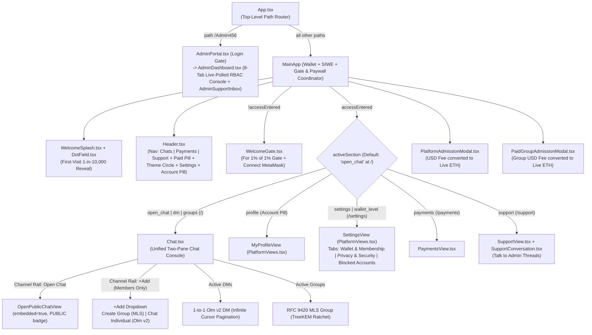

# Frontend Architecture & Technical Implementation

## 1. Technology Stack

- **Framework**: [React 19](https://react.dev/) + [TypeScript](https://www.typescriptlang.org/) (strict mode)
- **Bundler**: [Vite 8](https://vite.dev/)
- **Styling**: Tailwind CSS v4 + CSS custom property design tokens (`index.css`)
- **Web3 Auth**: [ethers.js v6](https://docs.ethers.org/v6/) EIP-1193 MetaMask integration (SIWE signing & chain switching only)
- **E2EE Protocols**:
  - `@towns-protocol/vodozemac@0.1.0` (Olm v2 Double Ratchet + Ed25519)
  - `ts-mls@1.6.4` + `@hpke/core@1.9.0` (IETF RFC 9420 MLS TreeKEM)
  - Native W3C `SubtleCrypto` (`AES-256-GCM` IndexedDB vault & encrypted attachments)

---

## 2. Component Hierarchy & Navigation Routing

The top bar (`Header.tsx`) presents a clean `[Z] Zyphra` brand monolith (matching the `favicon.svg` tab icon) alongside **3 center navigation tabs** (`Messages`, `Membership`, `Contact Admin` with an unread reply badge), and a right-hand action cluster containing a **Paid Amount pill (`.topbar-paid-badge`)** showing the signed-in member's total verified ETH paid (`Paid: <amount> ETH`, linking to `/payments`), a **notification bell (`NotificationBell.tsx`)**, a **circular theme toggle button (`.theme-toggle-btn`)**, a member-gated **Settings** button (rendered strictly for MetaMask-connected members, opening `/settings`), and the **Connect to MetaMask** button (which provides a **1-click seamless authentication flow** connecting the wallet and immediately chaining the EIP-4361 SIWE signature request; once connected, it becomes an **Account Pill** displaying avatar, unique `@username`, and `Active member` / `Member` whose streamlined dropdown shows only the clickable profile header **`View & Edit Profile →`** and **`Disconnect Wallet`**). Before access is granted (`!accessEntered`), `Header` runs in `gated` mode (keeping the circular theme toggle and `Connect to MetaMask` button visible with generous top padding) and `MainApp` renders `WelcomeGate.tsx` (`For the one percent of the one percent.`, with `WelcomeGate.css`) while `WelcomeSplash.tsx` plays once on a browser's first visit (`main.tsx` also fires `warmUpBackend()` on load). If a connected member has not paid the platform admission fee, `PlatformAdmissionModal.tsx` appears showing the USD fee converted to ETH via the live oracle, the rate source, and the authorized treasury destination.

- **URL Synchronization (`MainApp` in `App.tsx` + `vercel.json`)**: Keeps the browser URL synchronized across `/`, `/settings`, `/payments`, and `/support` via `history.pushState` and `popstate`. Direct access to `/settings` verifies wallet connection state before redirecting.
- **Standalone Admin Route (`/Admin456`)**: `App` routes `/Admin456` (case-insensitive) directly to `AdminPortal.tsx` (titled **`Admin`** in both the browser tab and topbar), which renders strictly a login form (`noindex, nofollow`) until the backend validates `ADMIN_LOGIN_ID` / `ADMIN_LOGIN_PASSWORD` and only then mounts `AdminDashboard.tsx` (`Overview`, `Users & Wallets`, `Groups & Policies`, `Payments`, `Free access` via `AdminFreeAccess.tsx`, `Moderation & Reports`, `Support Inbox` via `AdminSupportInbox.tsx`, `Platform Settings` with 2-column pricing fields and live WebSocket retention sync, and `Activity log`) with **automatic 5-second background polling** and instant single-query user filtering.
- **Unified Chat Console (`Chat.tsx`)**: Left conversation rail integrates:
  1. **Members' room** (`OpenPublicChatView`, module-cached per account for instant switching, Paid-Member gated read/post access, `viewing` & `online now` counters, dynamic retention warning banner showing `Messages kept for N days` synchronized in real time via `public_policy_updated` WebSocket event, smooth entrance glide `@keyframes chatMsgEntrance`, optimistic sending pulse, and circular animated header search).
  2. **Instant Isolated Switching**: Switching between Members' room, Private chats, and Groups swaps cached messages/state synchronously before paint (`useLayoutEffect`), serializes syncs per conversation scope, guards all async state writes with a generation + active-scope check, and parallelizes network fetches (`Promise.all`). Active chat headers place the circular animated `ChatSearchBar` and circular `⋮` `ConversationMenu` in the top-right (removing empty toolbar rows when no pins/chips/notices are active).
  2. **Composer Bar & Attachment Policy**: Compact `14px 24px` padding; the paperclip attachment icon has been hidden across Open Chat, DMs, and Groups (`canAttach={false}`) to streamline messaging, while file policy notices render strictly when files are selected.
  2. **Member-Gated `+Add` Control**: Rendered only when connected with MetaMask.
     - **Create Group**: Opens creation modal with group name, entry fee / thresholds, visibility, and member selection to initiate RFC 9420 MLS TreeKEM groups.
     - **Chat Individual**: Prompts for target `@username` or user ID to initiate an Olm v2 Double Ratchet private conversation.
  3. **Conversations List**: Dynamically displays all active 1-to-1 DMs and joined encrypted groups.
  4. **Paid Group Cards**: Displays entry fee in ETH and USD equivalent, providing a "Pay & Join Group" action opening `PaidGroupAdmissionModal.tsx`.
  5. **Dual Presence Model**: Displays live `Watching` viewers (for all visitors) and `Active Live` connected non-admin members (strictly visible to connected members; admins excluded).
- **Pure Identity Model in Profile (`MyProfileView`)**: Redundant display names have been removed to prevent user confusion and impersonation. Users manage their unique `@username` (with real-time availability feedback via `GET /account/username/check`) and optional bio.

---

## 3. Service Layer (`frontend/src/services/`)

| Module | Purpose |
| :--- | :--- |
| `web3.ts` | MetaMask EIP-1193 account detection, EIP-191 `personal_sign` for SIWE challenges, Mainnet/Sepolia chain switching, and `BigInt` Wei/ETH formatting. |
| `e2eeVault.ts` | Non-extractable (`extractable: false`) `AES-256-GCM` WebCrypto master key in IndexedDB (`zyphra_e2ee_vault_v2`) wrapping all local secrets and cached envelopes. |
| `olmService.ts` | Vodozemac Olm v2 account/session lifecycle, Ed25519 bundle signing, OTK replenishment, and 60-digit Safety Numbers. |
| `mlsGroupService.ts` | RFC 9420 MLS `KeyPackage` generation, `Create`/`Add`/`Remove`/`Update` Commits, `Welcome` onboarding, and `PrivateMessage` AEAD. |
| `e2eeAttachmentCrypto.ts` | On-device `AES-256-GCM` file encryption and `SHA-256` ciphertext verification. |
| `deviceProvisioning.ts` | Single-flight E2EE device registration & MLS KeyPackage provisioning (`ensureLocalDeviceRegistered`) shared across `App.tsx` and `Chat.tsx`. |
| `deviceRevocation.ts` | Safe vault-wipe decision helper (`shouldWipeLocalDevice`): wipes local E2EE keys/sessions/history strictly when the server explicitly confirms local device revocation (never on suspended/muted or permission `403`s). |
| `e2eeRealtime.ts` | Shared `/ws/e2ee` subscriber tracking connection state (`isE2EERealtimeLive()` from `authenticated` / `ws_closed` events) so `Chat.tsx` uses a `30 s` safety poll while connected and `4.5 s` fallback only when disconnected (pausing hidden tabs). |
| `chatEvents.ts` | Encrypted event folding (reactions, edits, polls, deletes) and `isSingleEmoji` validator mirroring backend `is_single_emoji` (supports keycaps, flags, skin tones, and ZWJ sequences). |
| `e2eeApi.ts` | Typed REST & `/ws/e2ee` client (emitting `ws_closed` on disconnect) for SIWE auth, identity/wallet linking, device bundles, Olm DM relay, and MLS group commits/messages. |
| `platformApi.ts` | Typed REST & `/ws/public-chat` / `/ws/member-presence` client for pricing, membership status, RPC wallet verification, Open Public Chat, `@username` search, blocks, read receipts, group policies/invites/join requests, reports, "Talk to admin" support threads, `/Admin456` session login (`adminLogin`, `adminSessionValid`, `adminLogout`), and RBAC admin APIs. |
| `resilientFetch.ts` | Cold-start & transient error retry helper for idempotent (`GET`/`HEAD`/`OPTIONS`) requests (`resilientFetch`, `NetworkUnreachableError`, `backoffDelay`) plus `onWake` listener to reconnect WebSockets on `online` / `visibilitychange`. |
| `api.ts` | Health status check, `warmUpBackend()` (`GET /api/health?deep=1`), and backend base URL resolver (Node-safe for automated unit tests). |
