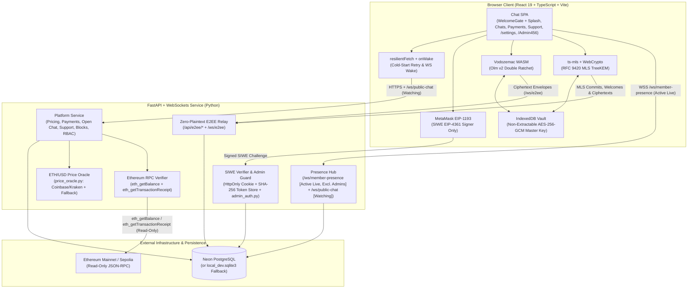
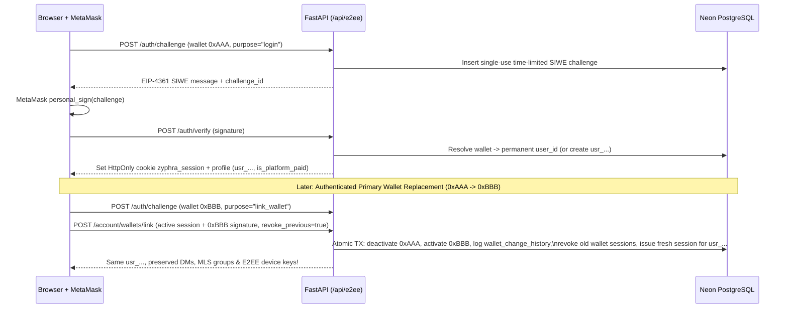

# System Architecture — Zyphra.in Chat Platform

**Zyphra.in** separates **Ethereum wallet authentication & on-chain balance verification** from **permanent internal account identity (`user_id`)** and **client-side End-to-End Encryption (E2EE)**.

---

## 1. High-Level Component Topology

---

## 2. Permanent Identity & Wallet Rotation Flow

Every account is anchored to an immutable `user_id` (`usr_<24-hex>`). Usernames (`@handle`) and Ethereum wallets (`0x...`) are changeable attributes tracked with full historical audit logs (`username_history`, `wallet_change_history`):
- **Case-Insensitive Uniqueness**: Guaranteed across both PostgreSQL and SQLite via functional partial index `CREATE UNIQUE INDEX idx_chat_users_username_lower ON chat_users (LOWER(username)) WHERE username IS NOT NULL`.
- **Live Availability Endpoint**: Fast debounced checking via `GET /api/e2ee/account/username/check` validates regex, active database claims, and 30-day quarantine status.
- **Pure Identity Model**: Display Name has been eliminated across all schemas and UI views. Public identity is strictly anchored to the cryptographically bound `@username` and the immutable `user_id`.
- **1-Click Seamless SIWE**: Connecting MetaMask automatically chains wallet account connection and the EIP-4361 SIWE signature request in a single interaction.

---

## 3. Platform Admission Paywall, Paid Groups & Server-Side Verified Payments

1. **Platform Admission Paywall (USD-Denominated with Live ETH/USD Oracle)**:
   - Platform admission fee is set in USD (`platform_entry_fee_usd` = the MONTHLY price, plus an optional `platform_yearly_fee_usd`; both default to `$0` = free until the admin sets them) and converted to ETH at quote time via `price_oracle.py` (Coinbase -> Kraken -> admin-configured `eth_usd_price` fallback, rounded up to 6 decimals), controlled via `platform_settings`.
   - Visitors start on `WelcomeGate` (after the one-time `WelcomeSplash`). Connected users without platform membership (`is_platform_paid == false`) are prompted with `PlatformAdmissionModal` displaying the USD fee, live ETH quote, rate source, and authorized treasury destination.
   - Access to the chat workspace is granted strictly after verified on-chain payment confirmation (`PAYMENT_PRICE_TOLERANCE_PCT`, default `5%`).
2. **Paid Groups**:
   - Specific groups can be tagged by administrators as Paid Groups (`is_paid = true`) requiring an individual USD entry fee (`entry_fee_usd`, migration `007`) converted to ETH at quote time.
   - Group admission is gated until an on-chain transaction matching the required fee is verified with `purpose: "group_entry"` and `target_id: group_id`.
3. **Authoritative On-Chain Payment Verification**:
   - `eth_rpc.py` queries Ethereum Mainnet (`1`) or Sepolia (`11155111`) via JSON-RPC (`eth_getTransactionReceipt` + `eth_getTransaction`).
   - **Verification Rules**:
     1. Transaction succeeded on-chain (`status == 1`).
     2. Sender matches the authenticated user's active wallet address.
     3. Recipient matches the server-controlled authorized treasury destination (`authorized_payment_destination`).
     4. Transaction is on an allowed chain/network.
     5. Transaction has not been previously recorded (strict anti-replay on `transaction_reference`).
   - Client-supplied balances, payment amounts, or recipient addresses are **never** accepted as authoritative.
   - Permanent records stored in `payment_records` with audit trail in `audit_logs`.

---

## 4. Messaging Security Boundaries

| Mode | Confidentiality Model | Protocol & Storage | Moderation & Access Control |
| :--- | :--- | :--- | :--- |
| **Open Public Chat** | **Public / Non-Confidential** (`PUBLIC` UI badge + `X-Chat-Room-Model: public-non-confidential`) | HTTPS/WSS transport; stored in `public_chat_messages` for public scrollback | Requires authenticated Paid Member (`_require_paid_member_ctx`, guest access removed); verified (`@username • VERIFIED`) badges, URI/burst spam guards, user block filtering, inline moderator removal, and user mutes/suspensions. **Presence**: `Watching` for public room viewers, `Active Live` member-only badge excluding Admins and hidden-presence users. |
| **Private 1-to-1 Chat** | **End-to-End Encrypted (E2EE)** | **Olm v2 Double Ratchet** (`@towns-protocol/vodozemac`), Ed25519 device bundles, 60-digit Safety Numbers + SAS | Server sees only opaque ciphertexts (`assert_zero_plaintext`). Enforces bidirectional `user_blocks`, opt-in read receipts, infinite cursor pagination (`after_seq`), and voluntary client-submitted abuse reports. |
| **Encrypted Group Chat** | **End-to-End Encrypted (E2EE)** | **IETF RFC 9420 MLS** (`ts-mls`), TreeKEM epoch ratcheting, `AES-256-GCM` attachments | Server enforces `group_access_policies` (`is_paid`, `entry_fee_eth`, `visibility`, `min_eth_balance_wei`) on invites, join requests, MLS `add` commits, and group posts; MLS enforces cryptographic pre-join and post-removal secrecy. Infinite cursor pagination (`after_seq`). |

---

## 5. Persistence, Reliability & Health

- **Database Layer**: Production connects to **Neon PostgreSQL** via `psycopg2.pool.ThreadedConnectionPool` (`DB_POOL_MIN=3`, `DB_POOL_MAX=10`) with liveness health checks (`SELECT 1` after `DB_POOL_VALIDATE_AFTER_SECS=5` idle seconds, plus retry on connect). If Neon credentials are unset in local development, it gracefully falls back to persistent **SQLite (`backend/local_dev.sqlite3`)** so data persists across restarts.
- **Cold-Start & Idle-Socket Recovery**: On initial load, `main.tsx` calls `warmUpBackend()` (`GET /api/health?deep=1`) to wake Render/Neon. If a pooled PostgreSQL connection drops (`OperationalError` / `InterfaceError` / `PoolError`), `app.py` flushes idle pool sockets (`purge_idle_connections()`) and responds with `HTTP 503` + `Retry-After: 1` (`retryable: true`) so `resilientFetch.ts` automatically retries idempotent `GET`/`HEAD`/`OPTIONS` calls with jittered backoff.
- **CORS & Middleware Ordering**: `CORSMiddleware` is registered outermost (after `detailed_request_logger`) so `413`/`500`/`503` responses also include CORS headers, and allows `FRONTEND_URL` origins plus any local dev/preview port (`localhost`, `127.0.0.1`, `[::1]`) via `allow_origin_regex`.
- **Transaction Rollback Protection**: Both SQLite and PostgreSQL connections roll back partial transactions upon errors to prevent multi-step write bleed.
- **Cross-Origin Session Recovery**: The client maintains session storage fallbacks for token verification across domains (`zyphra.in` on Vercel -> Render backend) and sets `SameSite=None; Secure` cookies in production HTTPS.

---

## 6. Relational Database Schema Summary (`migrations/` 001 through 008)

- **Identity & Auth**: `chat_users` (`is_platform_paid`, `platform_paid_at`), `username_history`, `chat_user_wallets`, `wallet_change_history`, `chat_auth_challenges`, `chat_auth_sessions`
- **E2EE Key Material & Envelopes**: `chat_devices`, `chat_one_time_prekeys`, `chat_mls_key_packages`, `chat_dm_messages`, `chat_dm_receipts`, `chat_groups`, `chat_group_members`, `chat_group_commits`, `chat_group_welcomes`, `chat_group_messages`, `chat_attachments`, `chat_identity_events`
- **Admission, Paid Groups & Payments**: `payment_records` (authoritative verified on-chain payments with `purpose` and `target_id`), `platform_settings` (`platform_entry_fee_usd`, `use_live_eth_price`, `eth_usd_price`, `authorized_payment_destination`), `group_access_policies` (`is_paid`, `entry_fee_usd`, `entry_fee_eth`, `entry_fee_wei`), `wallet_balance_snapshots`
- **Public Chat, Discovery & Support**: `public_chat_messages`, `user_blocks`, `group_invite_links`, `group_join_requests`, `support_threads`, `support_messages` (`008_support_threads.sql`)
- **Governance & Moderation**: `admin_roles`, `message_reports`, `moderation_actions`, `audit_logs`
