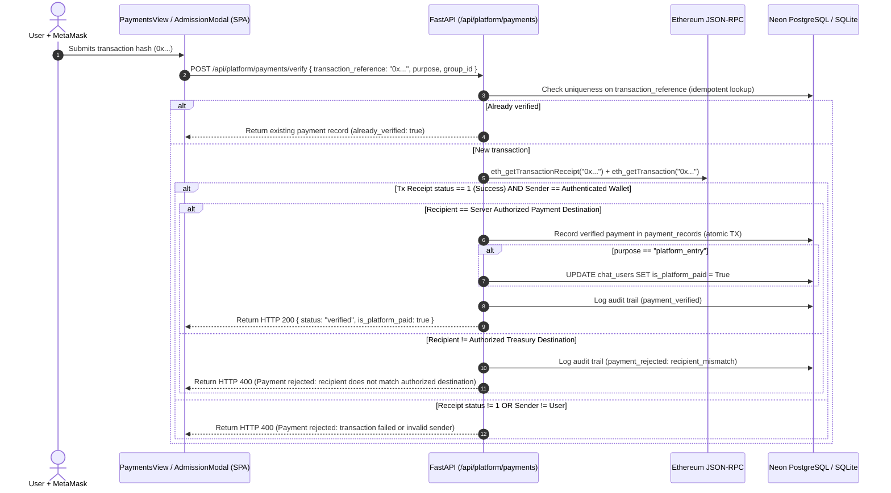

# System & User Workflows Specification

This document details the technical and user-facing workflows across **Zyphra.in**.

---

## 1. Welcome Gate, EIP-4361 (SIWE) 1-Click Onboarding & Platform Admission

```mermaid
sequenceDiagram
    autonumber
    actor User as User + MetaMask
    participant UI as Zyphra SPA (WelcomeGate / App.tsx)
    participant Vault as IndexedDB AES-256-GCM Vault
    participant API as FastAPI (/api/e2ee & /api/platform)
    participant PG as Neon PostgreSQL

    Note over UI: First browser visit shows WelcomeSplash once while warmUpBackend() pings /api/health?deep=1
    User->>UI: Clicks "Connect MetaMask" on WelcomeGate
    UI->>API: POST /api/e2ee/auth/challenge (wallet, purpose="login")
    API->>PG: Store single-use challenge (nonce + expiry)
    API-->>UI: EIP-4361 SIWE message + challenge_id
    UI->>User: MetaMask personal_sign(SIWE message) prompt
    User-->>UI: 65-byte EIP-191 signature
    UI->>API: POST /api/e2ee/auth/verify
    API->>PG: Create/resolve permanent usr_... + hashed session
    API-->>UI: HttpOnly cookie zyphra_session + user profile (including is_platform_paid)
    UI->>Vault: Unlock/create non-extractable AES-256-GCM master key
    UI->>UI: Generate Vodozemac Olm v2 identity + 15 OTKs + MLS KeyPackages
    UI->>API: POST /api/e2ee/devices/register (Ed25519-signed bundle)

    alt User has NOT paid platform admission fee (is_platform_paid == false)
        UI->>API: GET /api/platform/pricing
        API-->>UI: { platform_entry_fee_usd, platform_entry_fee_eth, eth_usd_price, rate_source, authorized_payment_destination }
        UI->>User: Displays PlatformAdmissionModal (USD fee converted to live ETH)
        User->>User: MetaMask eth_sendTransaction to authorized treasury destination
        User-->>UI: Returns tx_hash (saved in localStorage while confirming)
        UI->>API: POST /api/platform/payments/verify { tx_hash, purpose: "platform_entry" }
        API->>API: On-chain verify: status==1, sender==wallet, recipient==authorized_destination (with tolerance)
        API->>PG: Insert payment_record & UPDATE chat_users SET is_platform_paid = True
        API-->>UI: { success: true, status: "verified", is_platform_paid: true }
        UI->>UI: Access unlocked; user enters the Chat workspace as Paid Member!
    end
```

---

## 2. Paid Group Admission & On-Chain Verification Workflow

```mermaid
sequenceDiagram
    autonumber
    actor Member as Connected Member
    participant UI as Zyphra SPA
    participant API as FastAPI (/api/platform)
    participant RPC as Ethereum RPC Node
    participant PG as Neon PostgreSQL

    Member->>UI: Clicks "Pay & Join Group" on Paid Group card
    UI->>API: GET /api/platform/groups/{group_id}/pricing
    API-->>UI: { is_paid: true, entry_fee_usd, entry_fee_eth, eth_usd_price, rate_source, authorized_payment_destination }
    UI->>Member: Displays PaidGroupAdmissionModal (Group USD fee converted to live ETH)
    Member->>Member: MetaMask eth_sendTransaction(to: authorized_destination, value: entry_fee_wei)
    Member-->>UI: Returns tx_hash
    UI->>API: POST /api/platform/payments/verify { tx_hash, purpose: "group_entry", group_id }
    API->>RPC: eth_getTransactionReceipt(tx_hash) + eth_getTransaction(tx_hash)
    RPC-->>API: On-chain tx receipt & details
    API->>API: Verify: status==1, from==member_wallet, to==authorized_destination, amount>=fee
    API->>PG: Record payment in payment_records (purpose="group_entry", target_id=group_id)
    API-->>UI: { success: true, status: "verified", has_paid: true }
    UI->>UI: Modal closes; member admitted into the Paid Group!
```

---

## 3. Open Public Chat & Dual Presence Workflow

1. **Paid Member Read & Post Access (Default Landing at `/` once admitted)**: Opening the app after Welcome Gate admission lands on **Chats → Open Chat** (`PUBLIC` room badge in the left channel rail). Both `GET /api/platform/public-chat/messages` and `POST /api/platform/public-chat/messages` require an authenticated Paid Member (`_require_paid_member_ctx`), and live messages stream over `/ws/public-chat`. Legacy guest reading/posting toggles and endpoints are removed.
2. **Dual-Tier Presence Pipeline**:
   - **`Watching` Counter**: When any visitor opens Open Chat, the client connects to `/ws/public-chat`. The backend tracks live `watching` viewer counts.
   - **`Active Live` Counter (Member-Gated, Admins Excluded)**: When a non-admin member connects their MetaMask wallet, the client connects to `/ws/member-presence` passing the authenticated wallet address. `E2EERealtimeHub` excludes administrators (`superadmin`, `moderator`, `ADMIN_WALLET_ADDRESSES`) and users with `show_online_presence = false` from `active_live` counts and per-user online indicators (`is_user_online`). Non-connected visitors never see the `Active Live` metric.
3. **Paid-Member Composer & Admission Paywall**:
   - Unpaid members receive an admission paywall prompt (`PlatformAdmissionModal`) before reading or posting in Open Public Chat.
   - **Verified Member Post**: Admitted posts carry the user's permanent `user_id`, `@username`, and clean `VERIFIED` badge. Clicking any verified username opens a direct 1-to-1 encrypted chat with that user.
4. **Moderation & Safety**: Backend validates length (max 2,000 characters), sanitizes content, rejects dangerous URIs (`javascript:`, `data:text/html`), blocks burst spam (1 msg / 2.5s), and enforces user mutes/suspensions.

---

## 4. Olm v2 End-to-End Encrypted Private Chat Workflow

1. **Initiation via `+Add` or Directory**:
   - Connected members click **`+Add` → Chat Individual** in the left rail and enter the recipient's `@username` or `usr_...` ID.
   - Alternatively, members click **Browse Directory** or click any verified `@username` in the Open Public Chat stream.
2. **Block & Mutual Privacy Check**: Server verifies neither participant has blocked the other (`user_blocks`) and enforces mutual non-suspended status.
3. **3DH + Double Ratchet Handshake**:
   - Alice queries Bob's active Ed25519 device bundle(s) (`GET /api/e2ee/users/{bob_id}/devices`).
   - For any target device without an established session in `e2eeVault.ts`, Alice claims a single-use One-Time Prekey (`POST /api/e2ee/prekeys/claim`).
   - Alice initializes an outbound **Vodozemac Olm v2** session and generates ratchet-encrypted envelopes for each of Bob's active devices and Alice's own secondary devices.
   - Alice relays ciphertexts via `POST /api/e2ee/dm/messages`, which are delivered in real time over `/ws/e2ee`.
4. **Infinite Message Cursor Pagination**:
   - Conversations fetch messages using cursor pagination (`after_seq`, `limit=100`) in a loop until the full backlog is loaded, ensuring conversations scale past 60 messages with zero truncation.
5. **Read Receipts**:
   - Key verification is not shown to members. Device changes are still recorded in the background (`evaluateAndRecordPeerTrust`).
   - When enabled, `POST /api/platform/dm/read-receipt` updates delivery watermarks (`last_read_seq`).

---

## 5. RFC 9420 MLS Group Chat, Paid Groups & Join Queue

Groups are created and managed directly inside the **Chats** console.

1. **Group Creation via `+Add`**:
   - A connected member clicks **`+Add` → Create Group**.
   - The creator enters a group name, optional description, privacy setting (`invite_only` or `public`), and initial members.
   - The client creates a local MLS group (`epoch = 0`), claims MLS `KeyPackage`s for all selected members and the creator's secondary devices, and atomically registers the group (`POST /api/e2ee/groups`) and submits the Epoch 1 `Add` Commit with encrypted `Welcome` packages.
2. **Paid Group Access Policies**:
   - Groups tagged as Paid Groups require an on-chain fee in ETH.
   - Members pay via `PaidGroupAdmissionModal` and verify with `purpose: "group_entry"` before being admitted into the group.
3. **Discovery & Join Requests**:
   - Public discoverable groups appear under **Browse Groups & Invites** (`GET /api/platform/groups/discover`).
   - Eligible users submit join requests or redeem invite tokens (`POST /api/platform/groups/join-by-invite/{invite_code}`).
4. **1-Click MLS Onboarding**:
   - Group Admin reviews applicants in **Group Security & Policy → Join Requests** and clicks **Approve & Add**.
   - The admin's client claims the applicant's single-use MLS `KeyPackage`, executes an RFC 9420 `Add` Commit, and uploads the welcome bundle.
5. **Accept / Reject when an admin adds someone**:
   - An admin's `Add` Commit for someone who did not ask to join saves them as `invited`; the server holds their Welcome and sends a `group_invitation` event.
   - The invited member sees the invitation in the Groups list (and a pop-up) with **Accept** / **Reject**.
   - Accept (`POST /api/e2ee/groups/{group_id}/invitation/accept`) makes them `active`; their device then picks up the Welcome and the group opens.
   - Reject (`POST /api/e2ee/groups/{group_id}/invitation/decline`) marks them `declined` and deletes the Welcome. The admin can invite them again later, and can cancel an open invitation with **Cancel invite**.
6. **Member Removal or Self-Leave**:
   - Group admin removal submits an MLS `Remove` Commit advancing TreeKEM path secrets to guarantee **post-removal secrecy**.
   - Members can leave at any time via `POST /api/platform/groups/{group_id}/leave`, which safely clears local vault state and purges unconsumed welcomes.

---

## 6. On-Chain Payment Verification & Recipient Validation Workflow



---

## 7. Standalone Admin Console Login Workflow (`/Admin456`)

1. **Isolated Route Gate**: Navigating directly to `/Admin456` mounts `AdminPortal.tsx` (marked `noindex, nofollow` and unlinked from the public header). No admin dashboard UI or `/api/platform/admin/*` data requests are issued until authentication succeeds.
2. **Hardened Server-Side Verification**:
   - Submitting the login form calls `POST /api/platform/admin/login` (`extra="forbid"`).
   - `admin_auth.py` applies the global failure slowdown (no IPs, no lockout) and the cap on simultaneous attempts, then compares `SHA-256` digests of both `login_id` and `password` in constant time (`hmac.compare_digest`) against `ADMIN_LOGIN_ID` and `ADMIN_LOGIN_PASSWORD` from `backend/.env` (`503` if unset; fixed delay + generic `"Invalid credentials"` on mismatch; zero SQL executed).
3. **Ephemeral Session & Sign Out**:
   - On success, the backend issues a 256-bit random token stored in server memory solely as `SHA-256(token)` with a `30`-minute idle timeout and `4`-hour absolute TTL.
   - The client keeps the token in `sessionStorage` (`zyphra_admin_session`, cleared on tab close), re-validates on reload via `GET /api/platform/admin/session`, attaches `X-Admin-Token` on admin API calls, and revokes immediately via `POST /api/platform/admin/logout` on **Sign Out**.

---

## 8. "Contact Admin" Support Conversation Workflow (`/support`)

1. **Thread Creation (`SupportView.tsx`)**: Any signed-in user (paid or unpaid) opens **Contact Admin** (`/support`) and submits a subject + initial message (`POST /api/platform/support/threads`, up to `5` open threads per user).
2. **Admin Triage (`AdminSupportInbox.tsx`)**: Moderators/admins view open or closed threads in `/Admin456` → **Support** (`GET /api/platform/admin/support/threads`), open a thread (`GET /api/platform/admin/support/threads/{thread_id}`, clearing `admin_unread`), and reply (`POST /api/platform/admin/support/threads/{thread_id}/reply`), which logs an audit entry and pushes a live `support_reply` event over `/ws/e2ee`.
3. **Status & Reopen**: Admins can mark threads `open` or `closed` (`POST /api/platform/admin/support/threads/{thread_id}/status`). A member replying to a closed thread automatically reopens it.
